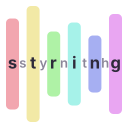

<p align="center"></p>

# Synth String

A plug-and-play guitar looper for GNOME (GTK 4 + libadwaita, Rust).

- **Auto device detection**: instrument interfaces (USB devices with both input and output, such as the
  Sonicake Pocket Master) are preferred over webcams and USB mics. Hot-plugging works, and your choice is
  remembered.
- **Threshold-triggered recording**: press <kbd>Space</kbd>, pick up the guitar, play. Recording starts
  at your first note, and silence before it and after your last note is trimmed automatically.
- **Looping**: the first take sets the loop length. Every later layer records exactly 1×–8× the
  loop, starting whenever you begin to play, with latency compensation and seamless seams.
- **Adaptive layout**: in a wide window (≥ 1200 px, e.g. maximised) the content uses the full width, the
  drum machine sits next to the transport, and the timeline gets taller.
- **Timeline**: a summed waveform of everything you hear with a playhead. Click or drag it to jump.
- **Song mode**: turn the loop into a song of N repetitions (e.g. 12). Each track gets a lane, and you
  click repetitions to place or remove it, so a solo can play only in repetitions 2–4. A layer recorded in
  song mode is placed where you played it, exactly in playing order: it starts at the repetition you
  started in, and runs into the next one if you started mid-repetition. New layers can be 1×, 2×, 3×, 4×, 6× or 8× the loop. A clip
  that runs past the last repetition wraps around to the start, because the song loops. In the export it
  instead finishes after the last pass.
- **Filter curves** (song mode): switch the timeline to *Filter* and draw on a track's lane. Below the middle
  line means less treble (low-pass), above it less bass (high-pass). The drawn shape, such as a slow close
  over one repetition and opening again later, is saved, plays back every time and is exported.
  Right-click a repetition to open the filter again.
- **Projects**: save and open `*.synthstring` files (Ctrl+S / Ctrl+O). They keep the raw takes, effects,
  noise profiles, mix and arrangement, so everything stays editable. You can also open a project with
  `synth-string song.synthstring`.
- **Global speed** (×0.25–×4, any value): everything plays faster or slower at the same pitch. Only the
  absolute time changes: loop length, click and BPM follow, while clips, track lengths in loops, drum
  patterns, fades and filter curves keep their places. Recorded audio is never altered, because each
  track remembers the speed it was recorded at, so ×1.00 always sounds exactly as recorded.
- **Metronome** with tap tempo. With the click on, loops snap to whole bars.
- **Noise reduction**: a live noise gate on the monitor, plus spectral noise reduction on recorded
  takes. It switches on automatically when the input is noisy.
- **Per-track FX** (non-destructive): speed at the same pitch, either 2–4× faster (the track repeats to
  fill its slot) or ½× / ¼× slower (the track becomes 2× / 4× as long),
  pitch shift by octaves (−2…+2) and/or an interval (e.g. a 4th or 5th up or down, with blend), drive, tone, tempo-synced echo, reverb, reverse, and fade in / out
  over 1–8 repetitions. In song mode a fade applies to each stretch of repetitions the track plays in, and
  the timeline lane shows the volume curve. In loop mode it applies to the start and end of the export.
- **Import audio** (MP3, WAV, FLAC, OGG, M4A/AAC, ALAC, AIFF; Ctrl+I). With no loop yet, the file (silence
  trimmed) becomes the loop. Otherwise you pick a length of 1×–8× the loop and either *stretch to fit*
  (keeps pitch) or *cut / pad*.
- **Drum machine**: synthesized kick, snare, hi-hat, clap and tom (no samples needed), played with
  A S D F G / J K L Ö Ä (`;` `'` on US layouts) or the pads. While a layer is recorded, a step grid shows
  the pattern with a playhead; click a cell to add or remove a hit. *Record drum layer* builds a pattern pass after pass. Snap (off, 1/2, 1/4, 1/8, 1/16) applies
  to the hits you play from then on, so one layer can mix a quarter-note kick with 1/16 hi-hats. Changing
  it while recording re-snaps the layer. Early hits are held back to the grid point, so they already
  sound in time while you play. You can undo the last hit with Ctrl+Z. Without a loop, the drum
  layer defines one (1, 2, 4 or 8 bars at the current tempo), and the pattern repeats over that length.
  Patterns are saved with the project, so you can add hits later.
- **MIDI footswitch** control with *learn*. The first unmapped message offers to become your record switch.
- **Export** to 24-bit WAV: the arranged song (or N loop repeats) plus optional per-track stems. If the
  mix would clip, it is normalised instead of limited, so there is no distortion.

## Build & run

Requirements (Fedora): `gtk4-devel libadwaita-devel alsa-lib-devel` (plus the PipeWire ALSA plugin,
which is installed by default). Rust ≥ 1.85.

```sh
cargo run --release          # run from the source tree
./install.sh                 # install to ~/.local (app grid entry + icon)
./install.sh --remove        # uninstall
```

The dock / dash icon comes from the installed `.desktop` file: GNOME matches the window's app id
(`dev.synthstring.SynthString`) to it. Once installed, the icon also shows for `cargo run`.

## Shortcuts

| Key | Action |
| --- | --- |
| Space | Record / finish loop / add a layer |
| Enter | Play / pause |
| Esc | Cancel recording |
| M / T | Metronome / tap tempo |
| Ctrl+Z | Undo last layer |
| Ctrl+E | Export |
| Ctrl+S / Ctrl+Shift+S / Ctrl+O / Ctrl+N | Save / Save as / Open / New project |
| Ctrl+, | Preferences |

## Architecture

| File | Role |
| --- | --- |
| `src/audio/engine.rs` | ALSA I/O through PipeWire (`pipewire:NODE=<node>`), capture → lock-free ring → playback thread |
| `src/audio/looper.rs` | Real-time looper state machine (threshold trigger, trim, overdub, metronome, mixing) |
| `src/audio/denoise.rs` | Noise gate + STFT spectral subtraction |
| `src/audio/effects.rs` | Offline per-track FX, including the phase-vocoder octave shifter (rendered circularly) |
| `src/audio/devices.rs` | Device discovery (`pactl -f json`) and guitar-interface scoring |
| `src/midi.rs` | Hot-plug MIDI input + learnable mappings |
| `src/export.rs` | WAV export (follows the arrangement) |
| `src/project.rs` | Project file format |
| `src/audio/import.rs` | Audio file decoding (symphonia), resampling, fitting to the loop |
| `src/audio/drums.rs` | Drum synthesis + pattern rendering |
| `src/ui/extras.rs` | Import dialog and drum machine UI |
| `src/ui/song.rs` | Song mode, timeline widget, project save/load UI |
| `src/ui/*` | libadwaita UI |

Developer hooks: `SYNTH_STRING_DEMO=1` (or `=song`, `=drums`, `=slow`, `=tempo`) injects synthetic loops or plays a demo
beat, `SYNTH_STRING_IMPORT=file.mp3` imports at startup, `SYNTH_STRING_SIZE=1700x1000` sets the window size,
`SYNTH_STRING_SWITCH=1` cycles the input device
(regression test for device switching), `SYNTH_STRING_SNAPSHOT=out.png` renders
the window to a PNG, and `SYNTH_STRING_DEBUG=1` logs engine status once per second. With any of these set, the app runs as a
separate instance, so it doesn't interfere with a copy you already have open.

The icon / logo is generated by `tools/make_icon.py` (six flat pastel bars, text converted to Inter
outlines, so the SVG needs no fonts). Change the script and re-run it instead of editing the SVG.

Settings are stored in `~/.config/synth-string/config.json`.
